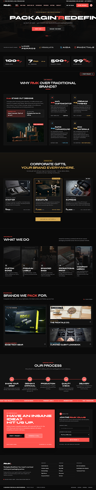

# RMK // Packaging Redefined • Avant Print Studio

An avant-garde, high-precision industrial dark-mode printing and packaging atelier web application built with **React 19**, **Vite**, and **Tailwind CSS**.



---

## 🎨 Design Philosophy & Aesthetic

The aesthetic fuses modern industrial brutalism with hyper-contemporary digital craftsmanship. It replaces dated corporate print tropes with:

- **Monochromatic Foundations**: `#0A0A0A` (canvas ground), `#121212` (structural panels), `#181818` (interactive cards and modules).
- **Electric Crimson Signals**: `#FF1F2D` (`#ff544e` / `primary-container`) reserved for high-priority user actions, live flash tags, and active interactive borders.
- **Metallic Gold Accents**: `#D4A853` applied exclusively to executive corporate gifting, luxury stock certifications, and premium tier signifiers.
- **Architectural Zero-Radius Sharpness**: Strictly 0px sharp corners across buttons, input fields, modal sheets, and showcase frames, echoing raw industrial sheet cutters and guillotine trimmers.
- **Avant-Garde Typography**:
  - **Headlines & Metrics**: `Syne` (weights 700, 800, 900) for sculptural curves, hot-metal typesetting, and bold numeric figures.
  - **Body & Labels**: `Space Grotesk` (weights 400, 600, 700) for engineered, technical precision and mono-feel labels.

---

## 🚀 Key Features

1. **Fixed Header & Dynamic Navigation**:
   - Live press-bed pulsing status ticker (`PRESS BED READY // HIGH-PRECISION RUNS`).
   - Smooth scroll anchor navigation with active section detection.
   - Quick "Get in Touch" & "Start Project" action triggers.
   - User profile dropdown / Atelier Client Portal quick overview.
   - Fully responsive mobile drawer menu.

2. **Hero Section (`PACKAGIN'REDEFINED`)**:
   - Atmospheric ambient imagery with factory line depth and radial dark-room gradients.
   - "Atelier Run Quality • High Precision Packaging" pinging badge.
   - Dual CTAs: *Start Now* and *Discuss Your Brief*.
   - Industrial 3-stage line indicator.

3. **Trusted by Market Leaders**:
   - Brand marks for *Lino Perros*, *Himalaya*, *AIDA*, and *Packtale*.

4. **Brutalist Key Metrics**:
   - `100+` Brands Served (`MTR-01`)
   - `7 Days` Average Turnaround (`MTR-02`)
   - `500+` Products & Finishes (`MTR-03`)
   - `99%` On-Time Delivery (`MTR-04`)

5. **Why RMK Bento Comparison**:
   - **01 Standout Designs**: Shelf dominance visual comparison, "Research says: Under 3 seconds" vs "Solution: Packaging that does the talking".
   - **02 100% Customization**: Zero templates, bespoke engineering.
   - **03 Premium Finishes**: Soft-touch matte, gold foiling, embossing, spot UV.
   - **04 Rapid Turnaround**: Express runs, 7-day average.
   - **05 Eco Materials**: FSC certified, 100% recyclable, soy inks.

6. **Corporate Gifting Collection**:
   - Tiered cards for **Starter** (₹699 / box), **Signature** (₹1,299 / box, Most Popular), and **Supreme** (₹4,999 / box, Top Tier).
   - High-res photography of real luxury unboxing sets with custom ribbon and accessories.

7. **What We Do (5 Core Capabilities)**:
   - Custom Boxes (Rigid, corrugated, folding cartons)
   - Premium Labels (High-tack roll labels, metallic foils, raised UV)
   - Branded Bags (Kraft totes, boutique bags, cord handles)
   - Promotional Print (Heavy GSM lookbooks, catalogs, certificates)
   - Company Merch (Laser-etched drinkware, titanium tools, textiles)

8. **Showcase / Selected Work Bento**:
   - **01 // Tech Hardware**: EDGE Tech Gear
   - **02 // Gourmet & Tea**: The Packtale Co.
   - **03 // Apparel & Lifestyle**: Curated Client Lookbook
   - Interactive modal inspection with client names, production specs, volume, and sample request.

9. **Interactive 5-Step Process Timeline**:
   - Steps: *01 Share Your Brief* ➔ *02 Design & Approval* ➔ *03 Production* ➔ *04 Quality Check* ➔ *05 Delivery*.
   - Live interactive progression state: hovering or clicking any milestone dynamically fills the illuminated crimson connector line and highlights gateways.

10. **Infinite Ticker Strip**:
    - Animated continuous ribbon with project categories and atelier specialties.

11. **Contact & RMK Club Newsletter**:
    - Left: "Have an Insane Idea? Hit Us Up." with rapid quote links.
    - Right: "Join the RMK Club" interactive form with company email, run volume selector, and submission confirmation.

12. **Start Project Modal & Quotation Calculator**:
    - Interactive dialog allowing clients to select format, finishes (Foil, Spot UV, Matte, Kraft), volumes, upload dieline vector files, and submit quotes.

13. **Legal & Documentation Modals**:
    - Die-line guidelines, sustainable inks/boards, turnaround schedules, privacy policy, and terms of service dialogs.

---

## 🛠️ Project Structure

```
rmk/
├── docs/
│   ├── code.html          # Original design template
│   ├── DESIGN.md          # Design system specifications
│   └── screen.png         # Full visual design preview
├── public/
├── src/
│   ├── components/
│   │   ├── CaseStudyModal.jsx      # Modal for inspecting showcase items
│   │   ├── ContactCta.jsx          # Contact & newsletter intake form
│   │   ├── FloatingCta.jsx         # Bottom-right quick quote button
│   │   ├── Footer.jsx              # Footer links, specs, & legal modals
│   │   ├── Gifting.jsx             # Corporate gifting tier showcase
│   │   ├── Header.jsx              # Navbar, announcement ticker, mobile menu
│   │   ├── Hero.jsx                # Cinematic hero with industrial branding
│   │   ├── LegalModal.jsx          # Guidelines, specs, & terms dialogs
│   │   ├── Metrics.jsx             # 4-column brutalist metric counters
│   │   ├── Process.jsx             # Interactive 5-step lifecycle timeline
│   │   ├── Showcase.jsx            # Bento grid of client case studies
│   │   ├── StartProjectModal.jsx   # Interactive quote intake modal
│   │   ├── TickerStrip.jsx         # Infinite marquee tape
│   │   ├── Toast.jsx               # Feedback notifications
│   │   ├── TrustedBy.jsx           # Client brand logo strip
│   │   ├── WhatWeDo.jsx            # 5 vertical capability cards
│   │   └── WhyRMK.jsx              # Bento grid comparison & shelf visual
│   ├── constants/
│   │   └── data.js                 # Centralized content, specs, & constants
│   ├── App.jsx                     # Root component orchestration
│   ├── index.css                   # Tailwind styles, scrollbar & animations
│   └── main.jsx                    # Application entry point
├── index.html                      # HTML root with Syne & Space Grotesk fonts
├── package.json                    # Dependencies & scripts
├── postcss.config.js               # PostCSS configuration
├── tailwind.config.js              # Custom color palette, typography & spacing
└── vite.config.js                  # Vite configuration
```

---

## 💻 Getting Started

### 1. Prerequisites
- **Node.js**: v18.0.0 or higher (v24+ recommended)
- **npm** or **pnpm**

### 2. Run Development Server
```bash
cd rmk
npm run dev
```

Open your browser at `http://localhost:5173`.

### 3. Build for Production
```bash
npm run build
```

Preview production build:
```bash
npm run preview
```
